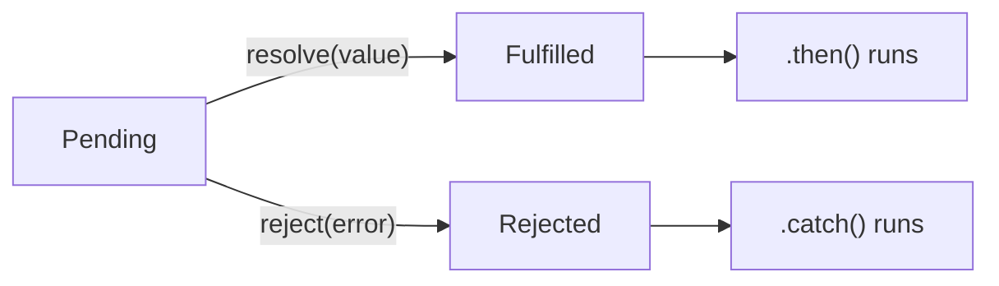

# Why Do You Need a Promise?

A concise guide to **why Promises exist in JavaScript**, covering the problem with operations that take time, what Promises give you, how they compare to callbacks, how they behave in practice, and their three states.

## 📄 Contents

This guide covers:

- Operations that take time
- What Promises give you
- Callbacks vs Promises
- Promises in practice
- The three states of a Promise
- How a Promise changes state
- Example: fulfilled vs rejected
- Key takeaways

## ⏱️ Some Operations Take Time

JavaScript does not wait for them. It keeps running and gets the result later. Operations like these are **non-blocking**: they work in the background and provide the result later.

- **Network requests**: getting data from a server takes time. The result arrives later.
- **File I/O**: reading or writing files, for example in Node.js, does not finish instantly.
- **Timers**: code scheduled to run after a delay runs later, not now.

Handling this in a clean, organized way can be difficult without a structured approach.

## ✅ What Promises Give You

1. **Handle async operations**: a Promise represents the result of an operation that isn't finished yet.
2. **A cleaner alternative to callbacks**: chain `.then()` calls instead of nesting functions inside functions.
3. **Less callback hell**: chaining keeps code flat, so deep nesting becomes far less likely.
4. **Readable, maintainable code**: one `.catch()` can handle an error from every step of a chain.

> A Promise doesn't make code async. It stands for the result of an async operation.

## 🔁 Callbacks vs Promises

The same three steps, written two ways.

**With callbacks:**

```javascript
getUser(id, (err, user) => {
  if (err) return handle(err);
  getOrders(user.id, (err, orders) => {
    if (err) return handle(err);
    getTotal(orders, (err, total) => {
      if (err) return handle(err);
      console.log(total);
    });
  });
});
```

**With Promises:**

```javascript
getUser(id)
  .then((user) => getOrders(user.id))
  .then((orders) => getTotal(orders))
  .then((total) => console.log(total))
  .catch(handle);
```

> One `.catch()` handles an error from any step in the chain.

## 💡 Promises in Practice

A timer wrapped in a Promise:

```javascript
const delay = (ms) =>
  new Promise((resolve) => setTimeout(resolve, ms));

delay(1000).then(() => {
  console.log("1 second later");
});
```

A network request with `fetch()`:

```javascript
fetch("/api/user")
  .then((response) => {
    if (!response.ok) throw new Error("HTTP " + response.status);
    return response.json();
  })
  .then((user) => console.log(user.name))
  .catch((error) => console.error(error.message));
```

> `fetch()` only rejects on network errors. Check `response.ok` for HTTP errors like 404.

## 🚦 The Three States

Every Promise is in exactly one of them:

| State | Meaning |
| --- | --- |
| **Pending** | The initial state. The operation has started, but its result isn't ready yet. |
| **Fulfilled** | The operation completed successfully, and the promise holds a value. |
| **Rejected** | The operation failed, and the promise holds a reason, usually an `Error`. |

## 🔀 How a Promise Changes State



- Once fulfilled or rejected, a promise never changes its outcome again.
- Rejecting is not throwing: the promise simply carries a reason. If nothing handles it, the runtime reports an unhandled rejection.

## ❌ Example: Fulfilled vs Rejected

A promise ends in only one of two ways, and each way runs its own handler.

```javascript
const ok = new Promise((resolve, reject) => {
  resolve("It worked");
});

const bad = new Promise((resolve, reject) => {
  reject(new Error("It failed"));
});

ok.then((value) => console.log(value));
bad.catch((error) => console.log(error.message));
```

Console output:

```
It worked
It failed
```

> Fulfilled runs `.then()`. Rejected runs `.catch()`.

## ✅ Key Takeaways

1. **Async operations take time**: network requests, file I/O and timers return their result later.
2. **A Promise holds the result**: it stands in for a value that isn't ready yet.
3. **Cleaner than callbacks**: chaining keeps code flat, readable and easier to maintain.
4. **One place for errors**: a single `.catch()` can handle a failure from any step.
5. **Three states**: pending, then fulfilled (with a value) or rejected (with a reason).
6. **A final outcome**: once settled, a promise never changes. A rejection is carried, not thrown.

## 📥 PDF

The complete guide is available in the PDFs below:

- **[Why Do You Need a Promise (English).pdf](./Why_Do_You_Need_a_Promise.pdf)**
- **[Why Do You Need a Promise (Persian).pdf](./Why_Do_You_Need_a_Promise_FA.pdf)**
